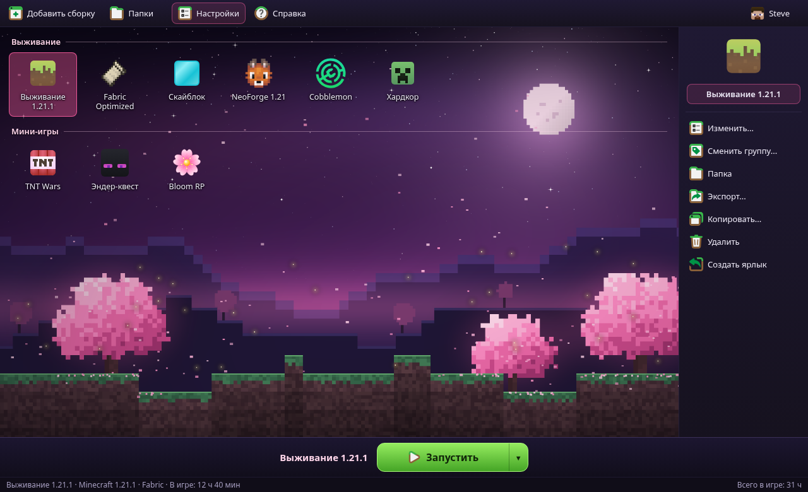

<p align="center">
  <picture>
    <source media="(prefers-color-scheme: dark)" srcset="program_info/org.bloomlauncher.BloomLauncher.logo-darkmode.svg">
    <source media="(prefers-color-scheme: light)" srcset="program_info/org.bloomlauncher.BloomLauncher.logo.svg">
    
  </picture>
</p>

<p align="center"><b>Красивый игровой лаунчер для Minecraft</b>: сборки, моды, ресурспаки и шейдеры в одном месте.</p>

<p align="center">
  <br>
  <sub>Примерный вид (макет)</sub>
</p>

## О проекте

Bloom Launcher — это **изменённая версия [Prism Launcher](https://github.com/PrismLauncher/PrismLauncher) 11.1.1** (изменения внесены 9 ноября 2026 г.).
Весь функционал Prism сохранён: изолированные сборки, Fabric / Forge / NeoForge / Quilt, моды и модпаки с Modrinth и CurseForge, управление Java, мирами, скриншотами и т. д.

- Проект не связан с командой Prism Launcher. Не отправляйте им сообщения об ошибках Bloom Launcher.
- Как и в Prism, нужен лицензионный аккаунт Microsoft. Офлайн-профили становятся доступны только после входа в аккаунт с купленной игрой.
- Minecraft — товарный знак Mojang / Microsoft. Проект с ними не связан.

## Что изменено

| Что | Как теперь |
|---|---|
| Название | **Bloom Launcher** везде: окна, файлы, установщики, Java-пакет `org.bloomlauncher`, папка данных (`%APPDATA%\BloomLauncher`, `~/.local/share/BloomLauncher`) |
| Тема | Новая тёмная тема **Bloom** (розово-фиолетовая, скруглённые элементы), включена по умолчанию |
| Главное окно | Нижняя панель в стиле TLauncher: название выбранной сборки и большая зелёная кнопка **«Запустить»** с меню (офлайн-запуск и т. д.) |
| Фон | Пиксельный пейзаж **Bloom Night** с сакурами и 3 сезонных варианта (день рождения, Хэллоуин, Новый год). Котики Prism тоже остались |
| Режим фона | Новый режим **Cover**: фон заполняет всё окно без искажений |
| Иконки | Новая иконка приложения, логотип, иконка сборки, файлы ICO / ICNS |
| Отключено | Автообновление, новости Prism, ссылки на Discord / Matrix / Reddit Prism, баг-трекер, ключи Microsoft / CurseForge / Imgur, выданные Prism |

По-прежнему используются публичные сервисы Prism: метаданные версий (`meta.prismlauncher.org`), переводы и справка. Строки, где раньше было «Prism Launcher», показываются на английском, пока для них нет перевода.

Тему и фон можно поменять в **Настройки → Внешний вид**.

## Перед сборкой (обязательно)

### 1. Вход через Microsoft: свой Client ID

Без своего Client ID вход в аккаунт Microsoft не работает. Использовать ID Prism в форках нельзя.

1. Откройте <https://portal.azure.com> → **Microsoft Entra ID → Регистрация приложений → Новая регистрация**.
2. Тип учётных записей: **«Только личные учётные записи Майкрософт»**.
3. **Проверка подлинности → Добавить платформу → Мобильные и классические приложения**. Добавьте URI перенаправления:
   - `http://127.0.0.1`
   - `http://localhost`
   - `bloomlauncher://oauth/microsoft`
4. Там же включите **«Разрешить потоки общедоступных клиентов»**.
5. Скопируйте **Идентификатор приложения (клиента)**.
6. Отправьте заявку Mojang на доступ к API Minecraft: <https://aka.ms/mce-reviewappid>. Пока её не одобрят, вход будет выдавать ошибку.
7. Укажите ID одним из способов:
   - GitHub → **Settings → Secrets and variables → Actions → Variables** → переменная `BLOOM_MSA_CLIENT_ID`;
   - или в `CMakeLists.txt`: `set(Launcher_MSA_CLIENT_ID "ваш-id" ...)`;
   - или при сборке: `-DLauncher_MSA_CLIENT_ID=ваш-id`;
   - в уже собранном лаунчере: **Настройки → Сервисы → Microsoft Authentication**.

### 2. Ключ CurseForge

- Получите ключ на <https://console.curseforge.com>.
- Укажите его: GitHub → **Secrets** → секрет `BLOOM_CURSEFORGE_API_KEY`, или `Launcher_CURSEFORGE_API_KEY` в `CMakeLists.txt`, или в лаунчере: **Настройки → Сервисы → CurseForge**.
- Без ключа не работает только CurseForge. Modrinth и остальные источники работают.

### 3. Ссылка на ваш репозиторий

В `program_info/CMakeLists.txt` замените `https://github.com/YOUR_GITHUB_NAME/BloomLauncher` на адрес своего репозитория.

### 4. Библиотека libnbtplusplus

`libraries/libnbtplusplus` — это git-подмодуль, в архиве его нет. Без него сборка остановится с подсказкой. Добавьте его командой из следующего раздела или вручную:

```bash
git clone https://github.com/PrismLauncher/libnbtplusplus.git libraries/libnbtplusplus
```

## Сборка через GitHub Actions (без установки Qt)

```bash
cd BloomLauncher-11.1.1
git init
git submodule add https://github.com/PrismLauncher/libnbtplusplus.git libraries/libnbtplusplus
git add .
git commit -m "Bloom Launcher 11.1.1"
git branch -M main
git remote add origin https://github.com/ВАШ_НИК/BloomLauncher.git
git push -u origin main
```

Дальше на GitHub: **Actions → Build → Run workflow**, в поле `build-type` укажите `Release`.
Когда сборка закончится, готовые файлы будут в разделе **Artifacts**: Windows (установщик и portable), Linux (AppImage и portable), macOS (DMG).

Подпись файлов необязательна. Без неё сборки получаются неподписанными:

- Windows SmartScreen может показать предупреждение: **Подробнее → Выполнить в любом случае**;
- на macOS первый запуск: правый клик → **Открыть**.

## Локальная сборка

Всё как у Prism Launcher: <https://prismlauncher.org/wiki/development/build-instructions/>

```bash
cmake --preset windows_msvc
cmake --build --preset windows_msvc --config Release
```

Другие пресеты: `linux`, `macos`, `macos_universal`, `windows_mingw`.

## Лицензия

GPL-3.0, как у Prism Launcher, PolyMC и MultiMC (см. `LICENSE` и `COPYING.md`).
Если вы распространяете сборки, публикуйте исходный код (например, этот репозиторий) и сохраняйте уведомления об авторских правах.
